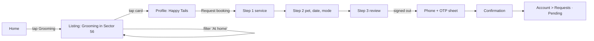
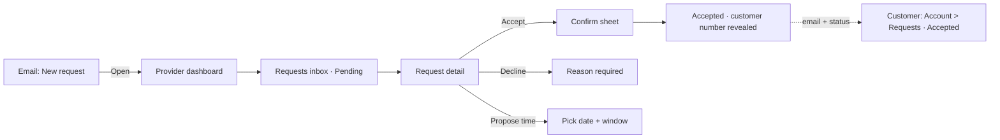
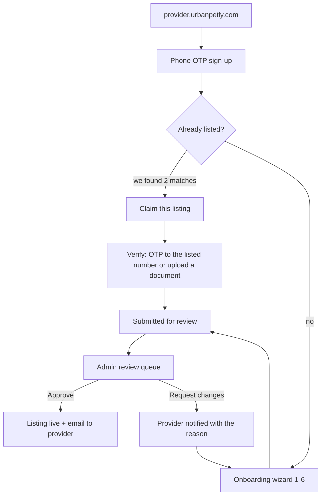

# Core flows — prototype script

Owner: UI/UX Designer · v0.1 · Spec: `05-ux-spec.md` §Core flows to prototype.

The three flows below are the prototype. Flow 1 is clickable today at
[`prototype/index.html`](prototype/index.html) — open it in a browser (no build step, no
dependencies) or serve the folder. Flows 2 and 3 are specified here screen by screen; their
screens are built in Phase 3 (`08-delivery-plan.md`), and the prototype is extended then
rather than inventing a provider UI before the API exists.

---

## Flow 1 — Parent finds a groomer near them, opens the profile, sends a request

**Persona:** Riya, Sector 56 Gurgaon, beagle named Simba, on a mid-range Android over 4G.
**Success:** request sent in under 90 seconds, with no doubt that nothing was paid or confirmed.



| # | Screen | What the user does | What must be true |
|---|---|---|---|
| 1 | [Home](home.md) | Taps "Grooming" | Location already shown as "Gurgaon · Sector 56"; one tap to results |
| 2 | [Listing](search-listing.md) | Adds the "At home" filter | Count updates and is announced; URL carries the filter |
| 3 | Listing | Taps Happy Tails | Card showed rating, distance, starting price and "At home" before the tap |
| 4 | [Profile](provider-profile.md) | Scans services and reviews, taps "Request booking" | Sticky bar reachable with one thumb; "no payment" reassurance visible |
| 5 | [Request 1](request-flow.md) | Picks "Full groom — dogs" | Preselected if entered from a ServiceCard |
| 6 | Request 2 | Picks Simba, Tue 21, Afternoon, At my home, address | Address required only for at-home; outside-area warning does not block |
| 7 | Request 3 | Reviews, taps "Send request" | Every line is editable in place; 72-hour expectation stated |
| 8 | OTP sheet | Enters phone, consents, enters 6-digit code | Draft survives; auto-submits after verification; no user enumeration |
| 9 | Confirmation | Reads "what happens next" | Focus lands on the heading; "View my requests" offered |

**Instrumentation (E12-S6):** `search_performed`, `filter_applied`, `provider_viewed`, `request_started`, `request_step_completed{step}`, `otp_requested`, `request_sent`. Search→enquiry conversion is a north-star metric (`00-product-brief` §7).

---

## Flow 2 — Provider receives the request, accepts, parent sees the update

**Persona:** Ankit, owns Happy Tails, two staff, runs the business from his phone.
**Success:** he can accept in two taps from the email, and Riya knows within seconds.



### Provider requests inbox — 360px

```
+------------------------------------------+
| Happy Tails              [🔔 2]  [☰]     |
+------------------------------------------+
| Profile 80% complete  [ Finish setup ]   |  completeness meter
+------------------------------------------+
| [ Pending 2 ] [ Accepted ] [ All ]       |  Tabs, pending first
+------------------------------------------+
| ┌──────────────────────────────────────┐ |
| │ [Pending]  expires in 71 h           │ |  Badge + countdown
| │ Riya S. · Full groom — dogs          │ |
| │ Tue, 21 Oct · Afternoon              │ |
| │ At home · Sector 54 (2.1 km)         │ |
| │ "Simba is nervous with clippers"     │ |
| │ [ Decline ] [ Propose ] [ Accept ]   │ |  44px row, primary right
| └──────────────────────────────────────┘ |
+------------------------------------------+
```

Rules:
- **Pending first, always**, sorted by soonest expiry. The expiry countdown is text, not just colour, and turns `warning` under 12 h.
- The customer's phone number is **hidden until accepted** (`06-nfr` privacy) — before that the card shows "Phone shared when you accept".
- Accept opens a confirm sheet (one line: "Accept Tue, 21 Oct, afternoon?") so a fat-finger tap cannot commit the business.
- Decline requires a reason (`decline_reason`); "Propose another time" reuses `DateWindowPicker`.
- Optimistic UI with rollback: the card moves to Accepted immediately; on failure it returns with a `role="alert"` toast and the action re-enabled.
- Empty state: "No pending requests. We'll email you when one arrives."

### Customer side of the same event

The request row in Account → Requests flips to an `Accepted` badge with the timeline step filled in, the provider's number appears with a "Call" action, and the email arrives (E4-S5). Status copy: "Happy Tails accepted · Tue, 21 Oct, afternoon". If the provider proposed a different time instead, the customer gets "New time proposed — Tue 21, morning" with "Accept" / "Decline" actions.

---

## Flow 3 — Provider signs up, claims or creates a listing, admin approves

**Success:** a non-technical owner finishes onboarding on a phone in one sitting, and the admin has enough to decide in under a minute.



### Onboarding wizard (6 steps, each saves a draft)

`1 Business info → 2 Categories → 3 Location pin → 4 Services and prices → 5 Photos → 6 Hours → Submit`

```
+------------------------------------------+
| ←  Set up your listing            Step 4 |
| ▰▰▰▰▱▱   Services and prices             |  Stepper + progress
+------------------------------------------+
| Add what you offer and what it costs.    |
| ┌──────────────────────────────────────┐ |
| │ Full groom — dogs                    │ |
| │ 90 min · ₹800 – ₹1,500               │ |
| │ [At centre] [At home]        [Edit]  │ |
| └──────────────────────────────────────┘ |
| [ + Add a service ]                      |
|                                          |
| ⓘ Listings with prices get 3x more       |  nudge, not a blocker
|   requests.                              |
+------------------------------------------+
| [ Save and exit ]        [ Continue ]    |  form rule: back/save left,
+------------------------------------------+  primary right, same row
```

Rules: every step autosaves a draft (`providers.status = 'draft'`) and shows "Saved" quietly; the wizard is resumable from any device; nothing is required except business name, category, location and one service; photos and hours are strongly nudged but skippable, because an abandoned listing helps nobody. The pin step defaults to the geocoded address and must be draggable, with the warning "Pet parents see this location" for at-centre providers.

### Claim flow

Shown when the signed-up phone or business name matches an unclaimed listing: "We found your business" with up to 3 candidate cards and "This is mine" / "None of these". Verification by OTP to the already-listed number, or a document upload reviewed by an admin (`03-data-model` `provider_claims`). Status copy while waiting: "We're checking your claim — usually within one working day."

### Admin review queue — desktop

```
+---------------------------------------------------------------+
| Review queue (7)   [Pending ▾] [Category ▾] [City ▾]   [Search]|
+---------------------------------------------------------------+
| ☐ | Business          | City    | Submitted | Completeness |   |
| ☐ | Happy Tails       | Gurgaon | 2 h ago   | 92%          | > |
| ☐ | Paws & Claws      | Noida   | 5 h ago   | 61%          | > |
+---------------------------------------------------------------+
| Detail panel: side-by-side draft vs live, photos, documents,  |
| map pin, duplicate-match warning.                             |
| [ Approve ]  [ Request changes (reason required) ]  [ Reject ] |
+---------------------------------------------------------------+
```

Rules: reason is mandatory for reject / request-changes / suspend (`05-ux-spec` §Admin, `06-nfr` audit); every decision writes an audit-log row; duplicate detection warns before approval; bulk approve is allowed only for low-risk fields, never for verification. The provider receives a plain-language email with the exact reason and a deep link back to the step that needs fixing.

---

## What is prototyped where

| Flow | Clickable now | Specified | Built in |
|---|---|---|---|
| 1 — find and request | `prototype/index.html` (Home → Listing → Profile → 3 request steps → OTP → Confirmation) | [home](home.md), [search-listing](search-listing.md), [provider-profile](provider-profile.md), [request-flow](request-flow.md) | Phase 1–2 |
| 2 — provider accepts | — | This document | Phase 3 (E4, E7) |
| 3 — sign-up to approval | — | This document | Phase 3 (E7, E8) |

When the base components land in Storybook, the prototype is replaced by real components at the same URLs; these specs stay the source of truth either way.
