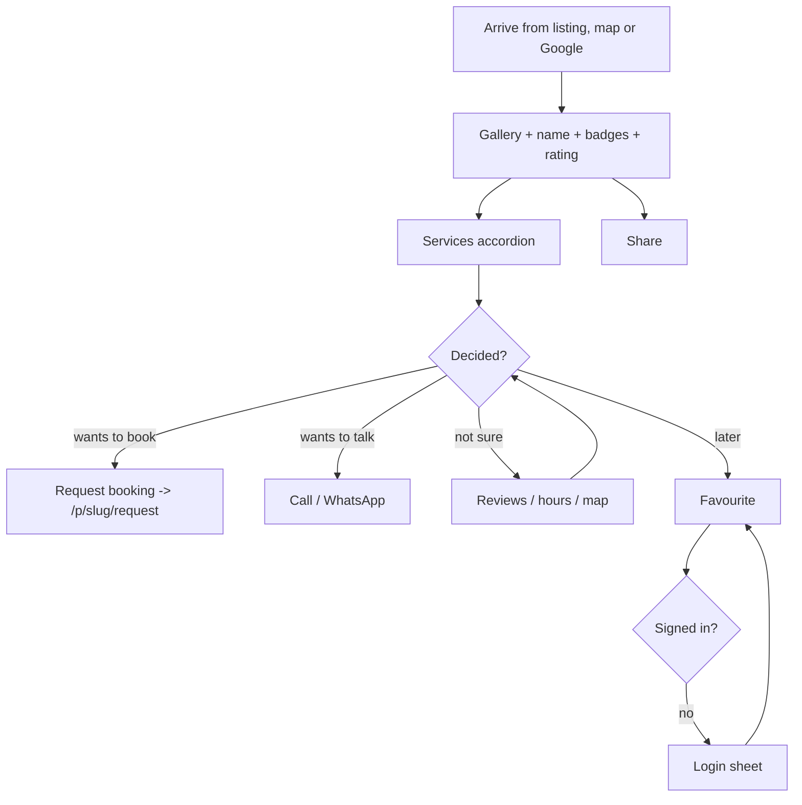

# Screen spec — Provider profile (`/p/{slug}`)

Owner: UI/UX Designer · v0.1 · Stories: E3-S1…S5 · Spec: `05-ux-spec.md` §Key screens 3.

This is where the decision is made. The page answers, in order: *Is this place real and good? What do they do and what does it cost? Can they come to me? How do I reach them?*

## User flow



## Wireframe — 360px

```
+------------------------------------------+
| ←                         [ ⤴ ] [ ♡ ]    |  overlaid on the gallery
| ┌──────────────────────────────────────┐ |
| │        gallery hero 3:2        3/12  │ |  swipe, dots, tap = lightbox
| └──────────────────────────────────────┘ |
+------------------------------------------+
| Happy Tails Grooming                     |  h1
| [Verified] [At home]                     |  Badges
| ★★★★☆ 4.6 (38 reviews)                   |  Rating display -> #reviews
| Sector 56, Gurgaon · 1.2 km away         |  body-sm, fg-muted
| [ Open now ] · Closes 8 pm               |  success badge + hours
+------------------------------------------+
| About                                    |  h2
| Full-service grooming for dogs and cats, |  body, clamp 4 lines
| at our centre or at your home.  Read more|
+------------------------------------------+
| Services and prices                      |  h2
| ▾ Grooming (4)                           |  Accordion per category
|   ┌──────────────────────────────────┐   |
|   │ Full groom — dogs                │   |  ServiceCard
|   │ 90 min · [At centre] [At home]   │   |
|   │ ₹800 – ₹1,500         [Request]  │   |
|   └──────────────────────────────────┘   |
|   ┌──────────────────────────────────┐   |
|   │ Nail trim · 15 min · [At centre] │   |
|   │ ₹200                  [Request]  │   |
|   └──────────────────────────────────┘   |
| ▸ Boarding (2)                           |
+------------------------------------------+
| Home visits                              |  h2 (only if at_home/both)
| Visits: Sector 54, 56, 57, DLF Phase 4   |
| and 6 more · up to 8 km                  |
+------------------------------------------+
| Hours                                    |  h2
| Mon–Sat  9:00 am – 8:00 pm               |  today's row is bold
| Sunday   Closed                          |
+------------------------------------------+
| Location                                 |  h2
| ┌──────────────────────────────────────┐ |
| │        [ static map, 16:9 ]          │ |  tap -> full map / directions
| └──────────────────────────────────────┘ |
| Shop 12, Sector 56 Market, Gurgaon       |
| [ Get directions ]                       |
+------------------------------------------+
| Reviews (38)                 ★ 4.6       |  h2
| 5★ ████████████░░  26                    |  distribution bars
| 4★ ████░░░░░░░░░░   8                    |
| …                                        |
| ┌──────────────────────────────────────┐ |
| │ R  Riya S.   ★★★★★   2 weeks ago     │ |  ReviewCard
| │ Gentle with my anxious beagle…       │ |
| │ ↳ Reply from Happy Tails: Thank you! │ |
| └──────────────────────────────────────┘ |
| [ Show all 38 reviews ]                  |
+------------------------------------------+
| Report this listing                      |  ghost, small
+------------------------------------------+
| ┌──────────────────────────────────────┐ |  STICKY bottom bar, z-sticky
| │ [ 📞 Call ]   [ Request booking ]    │ |  secondary + primary, 52px
| └──────────────────────────────────────┘ |  safe-area padded
+------------------------------------------+
```

## Components used

`Gallery/Lightbox`, `Badge`, `Rating` (display), `Accordion`, `ServiceCard`, `Map` (static preview + full), `ReviewCard`, `Button`, `IconButton`, `Skeleton`, `EmptyState`, `Modal/Sheet` (login, report, share), `Toast`.

## Section rules

**Gallery.** 3:2 hero, swipeable, counter, tap opens the lightbox. No photos → a branded placeholder on `primary-subtle` with the category glyph; never a stock photo of another business. The first image is the LCP element: eager, `fetchpriority="high"`, explicit dimensions.

**Identity block.** H1 is the business name. Badges in fixed order: Verified → Unclaimed → At home. Rating links to the reviews section. Distance appears only when the user's location is known.

**Unclaimed listings** (`00-product-brief` §6) show the `Unclaimed` badge, hide any owner-supplied marketing copy, and add a quiet line under the identity block: "Is this your business? **Claim this listing**" → claim flow. Only public business info is displayed.

**Services.** Grouped by category in an `Accordion`; the first category is open by default. Each `ServiceCard` shows name, duration, mode badges and price. Price formats: `₹800` (flat) · `₹800 – ₹1,500` (range) · `₹800 / hour` · "Price on request". "Request" jumps into the request flow with that service preselected.

**Home visits.** Rendered only when at least one service is `at_home` or `both`. Shows up to 6 localities then "and N more" (expands), plus `radius_km` when set (`03-data-model` `provider_service_areas`).

**Hours.** Seven rows, today bold with a leading dot. Open/closed is computed in IST and matches the header badge: "Open now · Closes 8 pm", "Closed · Opens 9 am Tue", "Closed temporarily" (E7-S5). Holiday overrides replace the day's row with "Closed — holiday".

**Location.** Static map image by default (cheap, fast); tapping loads the interactive `Map` or hands off to the device map app via "Get directions". Full address only — never a pin precise enough to be someone's home for home-only providers; those show the service area instead of a pin.

**Reviews.** Rating distribution bars (each bar has a text value beside it — not colour/length alone), newest 3 reviews, then "Show all". Provider replies are indented on `surface-sunken`. "Report" opens a sheet requiring a reason (`06-nfr` moderation).

**Sticky action bar.** Mobile only. "Call" is a `tel:` link (tracked, E3-S3) — the provider's business number, which is public. "Request booking" is primary. The bar appears after the user scrolls past the identity block and is padded for the home indicator. The customer's own phone number is never exposed here; it reaches the provider only after acceptance (`06-nfr` privacy).

## States

| State | Behaviour |
|---|---|
| **Loading** | Full-page skeleton matching the real layout: gallery box, two title bars, badge pills, three service rows. The sticky bar renders disabled with its labels visible, so the page height never changes. |
| **Error** | Full-page `EmptyState` "We couldn't load this profile" + "Try again" + "Back to results". |
| **Not found / removed** | Real 404: "This listing isn't available" / "It may have been removed. Here are similar providers nearby." plus 3 `ProviderCard`s. No soft-404 (`06-nfr`). |
| **Suspended / hidden by admin** | Same as not-found for the public; never leak a moderation reason. |
| **No photos** | Placeholder; the gallery does not collapse (no layout shift). |
| **No reviews** | "New on UrbanPetly" badge instead of a rating, and an `EmptyState` in the reviews section: "No reviews yet. Be the first after your visit." |
| **No services listed** | Services section shows "Services not listed yet" and the primary action becomes "Send an enquiry" (free-text request with no service id — `service_id` is nullable). |
| **Not accepting requests** | Primary button is disabled with a visible reason badge "Not taking requests right now"; "Call" stays enabled. |
| **Offline** | Cached profile stays readable; the sticky actions are disabled with "You're offline". |
| **Signed out** | Everything is readable. Favourite and Request open the login sheet and resume the original action afterwards — the user never loses their place. |

## Responsive

| Width | Layout |
|---|---|
| 360–767 | Single column in the order drawn; sticky bottom action bar. |
| 768–1023 | Gallery becomes a 2/3 + 1/3 mosaic. Content stays one column; the action bar moves into a card under the identity block (no longer sticky). |
| 1024+ | Two columns: left (66%) gallery, about, services, reviews; right (33%) a **sticky summary card** with rating, price-from, badges, hours, map thumbnail and the Call / Request buttons. |

## Copy

| Element | Text |
|---|---|
| Open state | Open now · Closes 8 pm |
| Closed state | Closed · Opens 9 am Tue |
| Verified tooltip | We checked this business's registration and contact details. |
| Unclaimed line | Is this your business? Claim this listing |
| Home visit area | Visits Sector 54, 56, 57, DLF Phase 4 and 6 more · up to 8 km |
| Price on request | Price on request |
| Primary action | Request booking |
| Secondary action | Call |
| Reassurance (under the bar on first scroll) | Free to request. The provider confirms — no payment here. |
| Reviews empty | No reviews yet. Be the first after your visit. |
| Report | Report this listing |
| Share toast | Link copied |

## Accessibility

- One `<h1>` (business name); each section is a `<section>` with an `<h2>` and `aria-labelledby`.
- The sticky bar must not cover content: `main` gets `padding-bottom` equal to the bar height, and focused elements use `scroll-margin-bottom`.
- Gallery: arrow keys navigate, Esc closes the lightbox, focus returns to the thumbnail, counter changes announced politely, every image has a descriptive `alt`.
- Accordion headers are buttons with `aria-expanded`/`aria-controls`; open/close never moves the page under the user's finger.
- Rating has a sentence-level accessible name; distribution bars pair the bar with its number.
- Hours are a `<table>` (or a `<dl>`) with the day as the row header, so "Tuesday: 9 am to 8 pm" reads correctly.
- "Call" is a real `<a href="tel:…">` with the number in its accessible name.
- The map is supplementary: the full address text and "Get directions" link give the same information.
- Colour never carries meaning alone: open/closed, verified and mode all pair an icon with text.
- Target size ≥44px for gallery dots, favourite, share, back and accordion headers.

## SEO notes (E9)

Top-N profiles are prerendered; the rest get server-injected meta and JSON-LD (`02-architecture` §6). `LocalBusiness` JSON-LD with `name`, `address`, `geo`, `telephone`, `openingHoursSpecification`, `aggregateRating`, `priceRange`, plus `BreadcrumbList`. Unique title: "Happy Tails Grooming — Grooming in Sector 56, Gurgaon | UrbanPetly". Reviews are rendered in the HTML, not injected only by JS.
