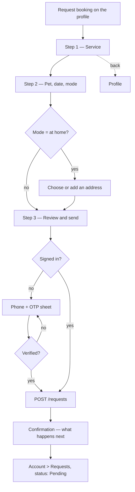

# Screen spec — Request flow (`/p/{slug}/request`)

Owner: UI/UX Designer · v0.1 · Stories: E4-S1, E4-S4, E4-S6, E1 (OTP inline) · Spec: `05-ux-spec.md` §Key screens 4.

Three steps, one screen each on mobile. The customer is asking for a slot, not buying one — every screen must make that obvious, because a parent who thinks they have paid will not call the groomer.

Payload maps 1:1 to `POST /requests` (`04-api-contract.md`) and `service_requests` (`03-data-model.md`): `service_id?`, `pet_id?`, `mode`, `address_id?`, `preferred_date`, `preferred_window`, `preferred_time?`, `note`.

## User flow



Draft state is kept in `sessionStorage` keyed by provider slug, so an interrupted OTP, a back-button press or a reload never loses the input.

## Step 1 — Choose a service

```
+------------------------------------------+
| ←   Request booking                  [×] |
| ●──────○──────○   Step 1 of 3            |  Stepper
+------------------------------------------+
| Happy Tails Grooming                     |  context row (avatar + name)
+------------------------------------------+
| What do you need?                        |  h1
|                                          |
| ▾ Grooming                               |  Accordion by category
|  ┌───────────────────────────────────┐   |
|  │ ◉ Full groom — dogs               │   |  selectable ServiceCard
|  │   90 min · ₹800 – ₹1,500          │   |  (RadioGroup semantics)
|  │   [At centre] [At home]           │   |
|  └───────────────────────────────────┘   |
|  ┌───────────────────────────────────┐   |
|  │ ○ Nail trim · 15 min · ₹200       │   |
|  └───────────────────────────────────┘   |
|                                          |
| ○ Something else — I'll describe it      |  -> service_id = null
+------------------------------------------+
|              [ Continue ]                |  sticky, full width, 52px
+------------------------------------------+
```

Arriving from a "Request" button on a `ServiceCard` preselects that service and the step still renders (so the choice is visible and changeable) with the selection scrolled into view.

**States:** default · selected · loading (3 card skeletons) · error (retry) · no services ("This provider hasn't listed services yet" — "Something else" is preselected) · unavailable service (disabled with "Currently unavailable") · validation ("Choose a service to continue", announced and focus moved to the group).

## Step 2 — Pet, when and where

```
+------------------------------------------+
| ←   Request booking                  [×] |
| ●──────●──────○   Step 2 of 3            |
+------------------------------------------+
| Which pet?                               |  h2
| [ 🐕 Simba ▾ ]  or  [ + Add a pet ]      |  Select / chips if <=3 pets
|                                          |
| When works for you?                      |  h2
| [Today] [Tomorrow] [Tue 21] [Wed 22] ›   |  date chips, 14 days
|                                          |
| [ Morning ] [ Afternoon ] [ Evening ]    |  window chips (8-12,12-4,4-8)
| ▸ Pick an exact time                     |  discloses -> preferred_time
|                                          |
| Where?                                   |  h2
| ( ) At the centre — Sector 56 Market     |  RadioGroup (modes offered
| (•) At my home                           |  by the chosen service only)
|                                          |
| Address                                  |  shown only for at_home
| [ Home — A-12, Sector 54 ▾ ]             |
| + Add a new address                      |
| ⓘ Outside this provider's visit area.    |  warning when pincode misses
|                                          |
| Anything else? (optional)                |  h2
| [ Simba is nervous with clippers…      ] |  Textarea, 300 chars
+------------------------------------------+
|              [ Continue ]                |
+------------------------------------------+
```

Rules: the mode radio only offers what the chosen service supports (`service_mode`); a single supported mode renders as a static line, not a radio. Address is required when mode is `at_home`. Elapsed windows for today are disabled. Days the provider is closed are disabled with "Closed" and remain readable.

**States:** default · selected · **no pets** (the pet field becomes "Add your pet" and opens a sheet — name, type, breed, age; a pet is optional, so "Skip for now" is offered) · **no addresses** ("Add your address" sheet) · **outside service area** (warning, not a block — "This provider may not visit Sector 12. You can still send the request.") · loading availability (chip skeletons) · validation errors per field, summarised at the top and focus moved to the first invalid field.

## Step 3 — Review and send

```
+------------------------------------------+
| ←   Request booking                  [×] |
| ●──────●──────●   Step 3 of 3            |
+------------------------------------------+
| Check and send                           |  h1
| ┌──────────────────────────────────────┐ |
| │ Happy Tails Grooming                 │ |  summary card
| │ Full groom — dogs · 90 min           │ |  each row has an Edit link
| │ ₹800 – ₹1,500            [Edit]      │ |  that returns to its step
| │ ──────────────────────────────────── │ |
| │ Simba (Beagle, 3 yrs)    [Edit]      │ |
| │ Tue, 21 Oct · Afternoon  [Edit]      │ |
| │ At my home · A-12, Sector 54 [Edit]  │ |
| │ "Simba is nervous…"      [Edit]      │ |
| └──────────────────────────────────────┘ |
|                                          |
| ⓘ This is a request, not a confirmed     |  info panel, primary-subtle
|   booking. Happy Tails has 72 hours to   |
|   reply. No payment is taken here.       |
|                                          |
| Your number +91 98765 43210 is shared    |  privacy note, body-sm
| with the provider only if they accept.   |
|                                          |
| ☐ I agree to the Terms and Privacy       |  only when signing up
|   Policy                                 |
+------------------------------------------+
|           [ Send request ]               |  sticky primary
+------------------------------------------+
```

### Inline OTP (signed-out users)

Pressing "Send request" when signed out opens a bottom `Modal/Sheet` — the draft is never lost and the user stays on the page:

```
+------------------------------------------+
| Confirm your number                  [×] |
| We'll text you a code so the provider    |
| knows you're real.                       |
|                                          |
| Mobile number                            |
| [ +91 | 98765 43210 ]                    |  PhoneInput
|                                          |
| ☐ I agree to the Terms and Privacy Policy|  consent_version recorded
|            [ Send code ]                 |
+------------------------------------------+
        ↓
+------------------------------------------+
| Enter the code                       [×] |
| Sent to +91 98765 43210  [Change]        |
| [ 1 ][ 2 ][ 3 ][ 4 ][ 5 ][ 6 ]           |  OtpInput, auto-submit
| Resend code in 0:29                      |
+------------------------------------------+
```

On success the sheet closes and the request is submitted automatically — the user does not press "Send" twice. `Idempotency-Key` is generated once per draft so a retry cannot create a duplicate (`04-api-contract` §Idempotency).

**OTP states:** default · sending · sent · wrong code ("That code is incorrect. 2 attempts left.") · expired ("Code expired — send a new one") · rate-limited ("Too many attempts. Try again in 15 minutes." — never reveals whether the number is registered) · network error. Copy never confirms or denies that an account exists (`06-nfr`).

## Confirmation

```
+------------------------------------------+
|                 ✓                        |  success circle, no confetti
|         Request sent                     |  h1
|                                          |
| Happy Tails Grooming has your request    |
| for Tue, 21 Oct, afternoon.              |
|                                          |
| What happens next                        |  h2
| 1  They reply within 72 hours.           |
| 2  We'll email you as soon as they do.   |
| 3  If they accept, you'll get their      |
|    number and they'll get yours.         |
|                                          |
| [ View my requests ]                     |  primary
| [ Back to Happy Tails ]                  |  secondary
|                                          |
| Looking for a backup? [ See similar      |  ghost link
| groomers nearby ]                        |
+------------------------------------------+
```

The request appears in Account → Requests with a `Pending` badge and a timeline (Sent → Accepted/Declined → Completed), plus "Cancel request" while pending (E4-S4). Auto-expiry after 72 h shows an `Expired` badge and the line "No reply from Happy Tails. Try another provider." (E4-S6).

## Components used

`Stepper`, `Accordion`, `ServiceCard` (selectable), `RadioGroup`, `Select`, `Chip`, `DateWindowPicker`, `Input`/Textarea, `Checkbox`, `Modal/Sheet`, `PhoneInput`, `OtpInput`, `Button`, `Badge`, `Toast`, `Skeleton`, `EmptyState`.

## States across the flow

| State | Behaviour |
|---|---|
| **Submitting** | "Send request" shows a spinner, keeps its label and width, `aria-busy="true"`; the form is disabled; no navigation until it resolves. |
| **Network error** | The draft is kept, a `role="alert"` message appears above the button: "We couldn't send your request. Try again." Retrying reuses the same `Idempotency-Key`. |
| **Validation** | Inline per field + a summary at the top of the step; focus moves to the first invalid control; the Continue button is never disabled without an explanation. |
| **Rate limited** (10 requests/user/day, `04-api-contract`) | "You've sent 10 requests today. Try again tomorrow." Draft kept. |
| **Provider stopped taking requests mid-flow** | Step 3 shows a `danger-subtle` panel: "Happy Tails isn't taking requests right now." + "See similar providers". |
| **Session expired at submit** | Reopen the OTP sheet with the draft intact; resubmit automatically after verification. |
| **Offline** | Submission is blocked with "You're offline. We'll keep your request here." and the draft is retained. |
| **Back / close** | The × asks "Discard this request?" only when something has been entered; the back arrow always returns to the previous step with values intact. |

## Responsive

| Width | Layout |
|---|---|
| 360–767 | One step per screen, sticky bottom action, bottom sheets for OTP/pet/address, Stepper as "Step 2 of 3" + progress bar. |
| 768+ | Steps stay sequential (lower error rate than one long form) but the content is centred at max 560px with a labelled dot Stepper; the action row sits inline under the content, "Back" left and primary right (`05-ux-spec` form rule); sheets become centred modals. |
| 1024+ | Two columns: form left, a sticky summary card (provider, service, price, date) right so the choice stays visible. |

## Copy

| Element | Text |
|---|---|
| Step titles | What do you need? · When and where? · Check and send |
| Reassurance (every step footer) | No payment here. The provider confirms. |
| Window labels | Morning (8 am–12 pm) · Afternoon (12–4 pm) · Evening (4–8 pm) |
| Note placeholder | Anything the provider should know? (optional) |
| Outside area | This provider may not visit Sector 12. You can still send the request. |
| OTP intro | We'll text you a code so the provider knows you're real. |
| OTP error | That code is incorrect. 2 attempts left. |
| OTP rate limit | Too many attempts. Try again in 15 minutes. |
| Privacy note | Your number is shared with the provider only if they accept. |
| Primary CTA | Send request |
| Success title | Request sent |
| Expiry note | No reply from Happy Tails. Try another provider. |
| Discard dialog | Discard this request? Your answers won't be saved. — "Keep editing" / "Discard" |

Never use "Book now", "Confirmed" or "Payment" anywhere in this flow.

## Accessibility

- Each step is a `<form>` with an `<h1>`; on step change focus moves to that heading and the step is announced ("Step 2 of 3, When and where").
- `<nav aria-label="Progress">` for the Stepper; current step `aria-current="step"`.
- Every control has a visible label. The date and window strips are labelled `radiogroup`s; the selection is echoed as text above the Continue button.
- Errors: `aria-invalid`, `aria-describedby`, a `role="alert"` summary, and focus moved to the first invalid field. Error text says what to do, not just what is wrong.
- The OTP sheet traps focus, autofocuses the first digit, supports `autocomplete="one-time-code"`, and returns focus to "Send request" if dismissed.
- The success screen sets focus to the "Request sent" heading so a screen reader hears the outcome immediately.
- Sticky actions respect the safe area and never cover the last field; the form scrolls with `scroll-padding-bottom`.
- Consent is an unchecked checkbox the user ticks — never pre-ticked (DPDP, `06-nfr`).
- Timers (OTP countdown) do not time out the form itself; nothing is lost if the user is slow (WCAG 2.2.1).
