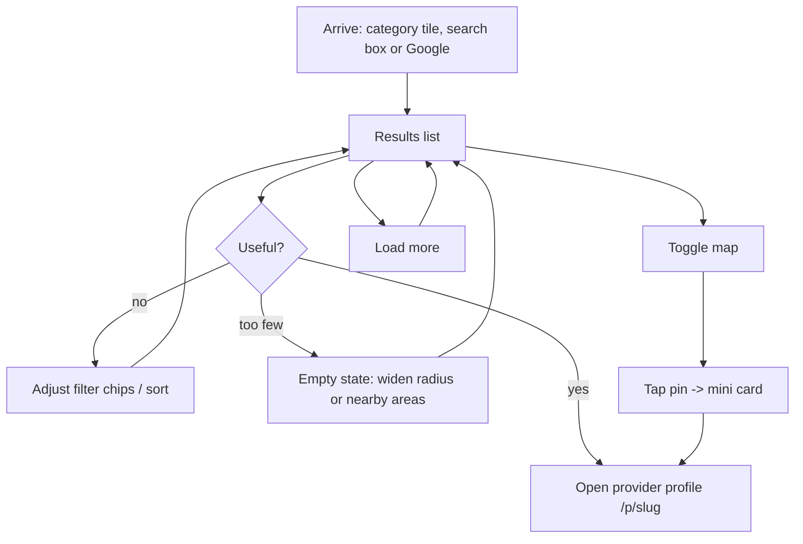

# Screen spec — Search and listing (`/search`, `/{city}/{category}`, `/{city}/{locality}/{category}`)

Owner: UI/UX Designer · v0.1 · Stories: E2-S1…S7 · Spec: `05-ux-spec.md` §Key screens 2.

Three URLs, one screen. `/search` is the interactive view; the two prerendered routes are the same component with filters pre-applied from the path and an SEO intro block (`02-architecture` §6).

## User flow



Every filter, sort, page and view change writes to the query string (`02-architecture` §5) — results are shareable and the back button works. Query params match `GET /providers` in `04-api-contract.md`: `q, category, city, locality, lat, lng, radiusKm, mode, minRating, maxPrice, openNow, verified, sort, page, pageSize`.

## Wireframe — 360px (list view)

```
+------------------------------------------+
| ←  Grooming in Sector 56         [♡] [⋮] |  header 56px, back = history
+------------------------------------------+
| [📍 Sector 56, Gurgaon ▾]   [ Map ▦ ]    |  location chip + view toggle
+------------------------------------------+
| ‹ [Filters · 2] [At home ×] [4★+ ×]      |  scrollable Chip row, 36px
|   [Open now] [Verified] [Under ₹1000] ›  |  active chips first, with ×
+------------------------------------------+
| 24 groomers · within 10 km   [Sort: Distance ▾]
+------------------------------------------+
| ┌──────────────────────────────────────┐ |
| │ [photo 4:3]                      [♡] │ |  ProviderCard
| │  Verified                            │ |
| │ Happy Tails Grooming                 │ |
| │ ★ 4.6 (38) · 1.2 km · Sector 56      │ |
| │ Starts at ₹800 · At home             │ |
| │ [ Open now ]                         │ |
| └──────────────────────────────────────┘ |
| ┌──────────────────────────────────────┐ |
| │ … next card …                        │ |
| └──────────────────────────────────────┘ |
+------------------------------------------+
|        [ Load more ]  Showing 20 of 24   |
+------------------------------------------+
```

## Wireframe — 360px (map view)

```
+------------------------------------------+
| ←  Grooming in Sector 56      [ List ☰ ] |
+------------------------------------------+
|                                          |
|        🔵        📍                      |  map fills the viewport
|            📍(selected, larger + ring)   |  [Search this area] appears
|   📍                 📍                  |  after a pan
|                                          |
| ┌──────────────────────────────────────┐ |
| │ [img] Happy Tails Grooming       [×] │ |  mini ProviderCard, shadow-md
| │ ★ 4.6 · 1.2 km · Starts at ₹800      │ |  tap -> profile
| └──────────────────────────────────────┘ |
+------------------------------------------+
```

## Components used

`FilterBar` (Chip row + Filters sheet + Sort select), `ProviderCard`, `Skeleton`, `EmptyState`, `Pagination` ("Load more" / numbered on prerendered pages), `Map`, `Badge`, `IconButton`, `Modal/Sheet`, `Combobox` (change location).

## Filters (the sheet)

| Facet | Control | Values |
|---|---|---|
| Service mode | Chip choice | Any · At the centre · At my home |
| Rating | Chip choice | Any · 3★+ · 4★+ · 4.5★+ |
| Price | Chip choice | Any · Under ₹500 · Under ₹1000 · Under ₹2000 (maps to `maxPrice`) |
| Distance | Chip choice | 2 km · 5 km · **10 km (default)** · 25 km (`radiusKm`; default per E2-S3) |
| Open now | Toggle chip | boolean |
| Verified only | Toggle chip | boolean |
| Pet type | Chip toggles | Dog · Cat · Bird · Other |
| Sort | Select | Relevance (default) · Distance · Rating · Price: low to high |

Sheet footer is sticky: "Clear all" (ghost) left, "Show 24 results" (primary) right, with a live-updating count. Closing without pressing the primary button discards the changes.

## States

| State | Behaviour |
|---|---|
| **Loading (first paint)** | Header, location chip and filter row render immediately; 4 `ProviderCardSkeleton`s with identical geometry to real cards. Count line shows a 120px skeleton bar. |
| **Loading (filter change)** | Existing results stay visible at 60% opacity, `aria-busy="true"` on the list; the count line shows a spinner. No layout shift, no scroll jump. |
| **Results** | As drawn. Count is announced politely: "24 groomers in Sector 56". |
| **Empty — filters too narrow** | `EmptyState` "No groomers match these filters" / "Try removing a filter or widening the distance." Actions: "Clear filters" (primary), "Search within 25 km" (secondary). The filter chips stay on screen so the cause is visible. |
| **Empty — no supply in the area** | "No groomers in Sector 56 yet" / "Here's what's nearby." Then up to 5 results from adjacent localities under a "Nearby areas" heading — never a dead end. |
| **Error** | Inline card in the results area: "We couldn't load results. Check your connection and try again." + "Try again" button. Filters and header stay usable. Never a blank page. |
| **Offline** | Toast "You're offline" and the last results stay visible, marked "Showing saved results". Filter controls are disabled with a reason. |
| **Location denied** | Distance sort and "near me" are disabled with the reason "Turn on location to sort by distance"; the locality `Combobox` is focused instead. Cards omit distance entirely rather than showing "— km". |
| **Partial (map tiles fail)** | Map area shows "Map unavailable — results are listed below" and auto-switches to list view. Results are never lost with the map. |
| **Unauthorized** | Not applicable — search is public. Favouriting while signed out opens the login sheet and resumes the favourite afterwards. |
| **End of results** | "Load more" is replaced by "That's all 24 results" + "Widen your search". |

## Responsive

| Width | Layout |
|---|---|
| 360–767 | One column of cards. Map is a **separate full-screen view** via the toggle (never a split screen). Filter chips scroll horizontally; the Filters sheet is a bottom sheet. |
| 768–1023 | Two-column card grid; Filters is still a sheet; map remains a toggle. |
| 1024+ | **Split view**: results in a left column (two cards wide, scrolls independently), sticky map on the right (40% width, full height). Hovering a card highlights its pin; selecting a pin scrolls its card into view and marks it `aria-current`. Filters become an inline bar; no sheet. |

## Copy

| Element | Text |
|---|---|
| Page title (listing) | Grooming in Sector 56, Gurgaon |
| Count | 24 groomers · within 10 km |
| Count (one) | 1 groomer |
| Sort labels | Relevance · Distance · Rating · Price: low to high |
| Load more | Load more · Showing 20 of 24 |
| End | That's all 24 results |
| Filters button | Filters · 2 |
| Clear | Clear all |
| Apply | Show 24 results |
| Map toggle | Map / List |
| Search this area | Search this area |
| Distance | 1.2 km away |
| Price | Starts at ₹800 |
| Error | We couldn't load results. Check your connection and try again. |

## Accessibility

- `<h1>` is the listing title ("Grooming in Sector 56, Gurgaon"); result cards use `<h3>`.
- Results are a `<ul>`; each card is one `<li>` with a single primary link. The favourite button is a separate control inside it.
- The result count lives in an `aria-live="polite"` region and announces after every filter change — this is how a screen-reader user knows the filter worked.
- Filter chips are `aria-pressed` toggles grouped in a labelled region ("Filters"); removing a chip returns focus to the chip row, not to the top of the page.
- After "Load more", focus moves to the first newly added card and the count is announced.
- The map is never the only path: the list contains every result shown on the map, and the map/list toggle is a labelled control, not an icon alone.
- Distance, rating and price use tabular numerals so rows do not jitter while loading.
- Skeletons are `aria-hidden`; the container announces "Loading results" once.
- Full keyboard path: Tab → skip link → location → filters → sort → cards → load more. Esc closes the Filters sheet and returns focus to the Filters button.

## SEO notes (E9, prerendered routes)

`/{city}/{category}` and `/{city}/{locality}/{category}` are prerendered with: unique title/meta, one H1, a 2–3 sentence intro paragraph above the results, `ItemList` + `BreadcrumbList` JSON-LD, **crawlable numbered pagination** with `<a href>` links, and internal links to sibling localities at the foot of the page. Filter changes on these pages switch to the `/search` URL shape via `history.pushState` without a reload.

## Performance

Target: LCP ≤ 2.5 s. Card images are WebP at 2 sizes with `loading="lazy"` except the first two; every image reserves its box (`aspect-ratio: 4/3`). The map bundle is **lazy-loaded only when the map view is opened** so it never counts against the list route's 200 KB gzip budget (`06-nfr`).
